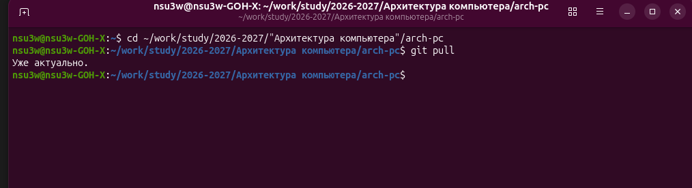
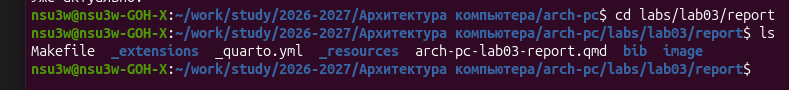
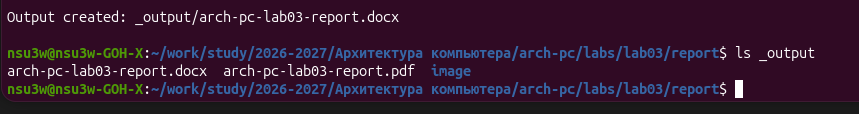
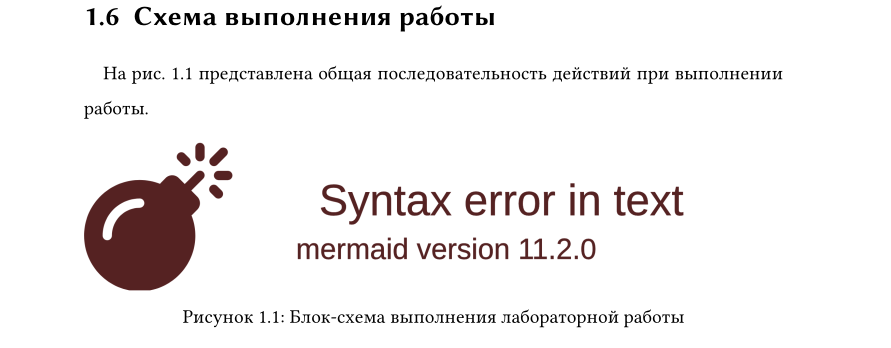
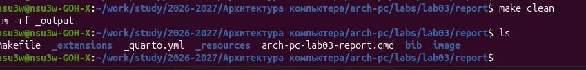
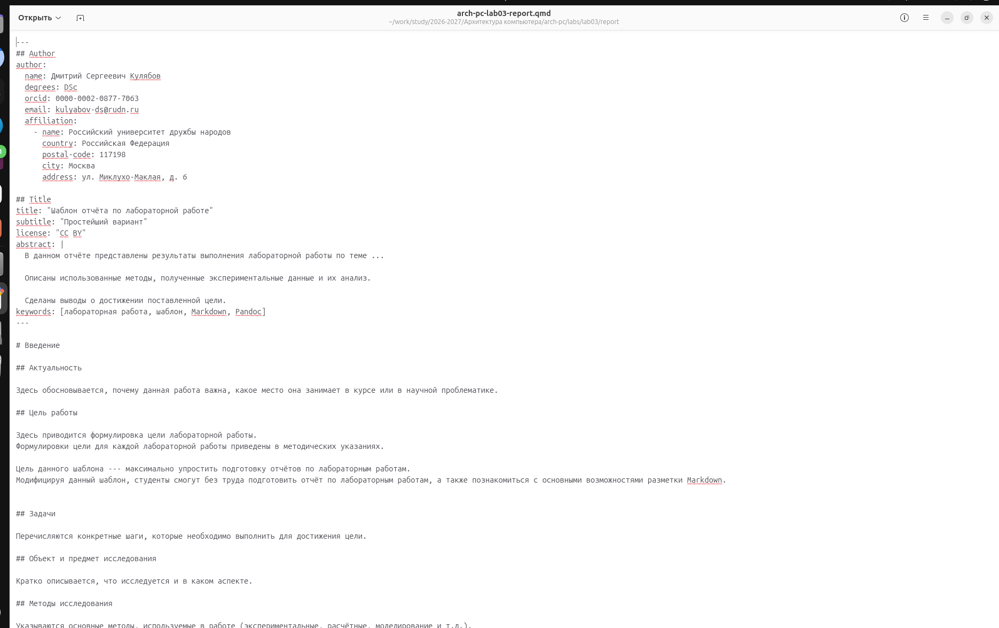
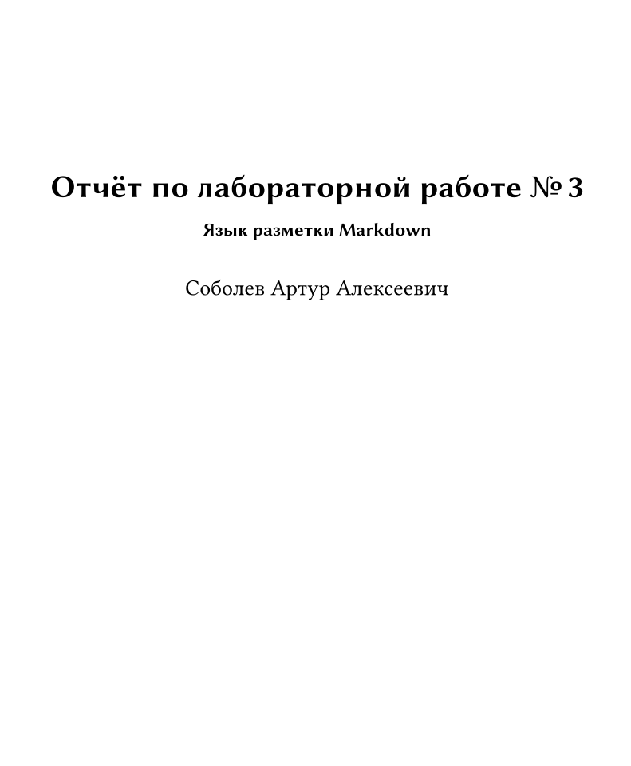
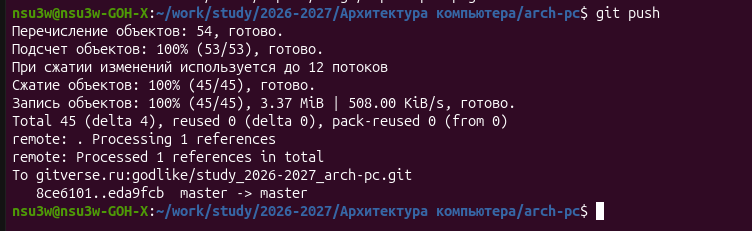

---
## Author
author:
  name: Никита Сергеевич Паклин
  degrees: DSc
  orcid: 0000-0002-0877-7063
  email: nicitapaklin@yandex.ru
  affiliation:
    - name: Российский университет дружбы народов
      country: Российская Федерация
      postal-code: 117198
      city: Москва
      address: ул. Миклухо-Маклая, д. 6

## Title
title: "Отчёт по лабораторной работе №3"
subtitle: "Язык разметки Markdown"
license: "CC BY"
abstract: |
  В данном отчёте представлены результаты выполнения лабораторной работы по теме "Язык разметки Markdown"

  Описаны использованные методы, полученные экспериментальные данные и их анализ.

  Сделаны выводы о достижении поставленной цели.
keywords: [лабораторная работа, шаблон, Markdown, Pandoc]
---

# Введение

## Актуальность

Отчёты по всем последующим лабораторным работам курса оформляются в Markdown. Markdown - простой текстовый формат: его удобно хранить в git, отслеживать изменения и из одного файла получать отчёт сразу в нескольких форматах (PDF, DOCX).

## Цель работы

Освоение процедуры оформления отчетов с помощью
легковесного языка разметки Markdown.

## Задачи

1. Скомпилировать шаблон отчёта с помощью Makefile и проверить полученные файлы.
2. Удалить полученные файлы с помощью Makefile.
3. Изучить структуру файла отчёта.
4. Заполнить отчёт и скомпилировать его в форматы PDF и DOCX.
5. Загрузить файлы в репозиторий на GitVerse.
6. Оформить в Markdown отчёт по лабораторной работе № 2.

## Объект и предмет исследования

Объект - шаблон отчёта по лабораторной работе. Предмет - синтаксис Markdown и процесс преобразования Markdown-файла в форматы PDF и DOCX.

## Методы исследования

Практическое выполнение команд в терминале Linux, редактирование файла отчёта в текстовом редакторе, проверка результата компиляции.

# Теоретическая часть

Markdown - легковесный язык разметки: оформление задаётся простыми символами прямо в тексте. Основные элементы приведены в табл. -@tbl-md.
Элемент	Запись в Markdown
Заголовок 1 уровня	# Heading
Полужирный	**text**
Курсив	*text*
Нумерованный список	1. item
Маркированный список	- item
Ссылка	[text](url)
Изображение	{#fig-id}
: Основные элементы разметки Markdown {#tbl-md}
Формулы записываются в синтаксисе LaTeX: внутри строки - между $, например $\sin^2(x) + \cos^2(x) = 1$; отдельной строкой - между $$ с меткой для ссылки:

\sin^2(x) + \cos^2(x) = 1

{#eq-trig}
На формулу (@eq-trig) можно сослаться по её метке @eq-trig, на рисунок - по метке @fig-..., на таблицу - по метке @tbl-....
Материалы и методы
Работа выполнена в ОС Fedora. Использованное программное обеспечение:
Quarto 1.7.34 - компиляция Markdown в PDF и DOCX (рис. -@fig-quarto);
TinyTeX - дистрибутив LaTeX для сборки PDF;
make - запуск команд из Makefile;
git - работа с репозиторием;
gedit - редактирование отчёта.

# Выполнение лабораторной работы

Выполнен переход в каталог курса командой cd, локальный репозиторий обновлён командой git pull (рис. -@fig-pull). Ответ «Уже актуально» означает, что новых изменений на сервере нет.
{#fig-pull width=90%}

Выполнен переход в каталог labs/lab03/report. Команда ls показала его содержимое: Makefile, файл настроек _quarto.yml, файл отчёта arch-pc-lab03-report.qmd и каталог image для изображений (рис. -@fig-ls).
{#fig-ls width=90%}

Команда make выполнила цель all из Makefile, которая запускает quarto render. В каталоге _output сформированы файлы отчёта в форматах PDF и DOCX (рис. -@fig-make).
{#fig-make width=90%}
При проверке PDF обнаружено, что блок-схема из шаблона не отрисовалась (рис. -@fig-mermaid): она записана в синтаксисе mermaid версии 11.3, а в Quarto 1.7.34 встроена версия 11.2.0. Поэтому схема была удалена из отчёта.
{#fig-mermaid width=80%}

Команда make clean выполнила rm -rf _output и удалила каталог с готовыми файлами (рис. -@fig-clean). Содержимое каталога совпало с исходным.
{#fig-clean width=90%}

Файл отчёта открыт в текстовом редакторе (рис. -@fig-editor). Он состоит из YAML-шапки между строками - (автор, название, аннотация) и текста отчёта, размеченного Markdown. Скриншоты размещаются в каталоге image.
{#fig-editor width=90%}

В шапке указаны автор, название и аннотация. Примеры из шаблона удалены, разделы заполнены описанием выполненной работы. Отчёт скомпилирован командой make (рис. -@fig-report).
{#fig-report width=60%}

Изменения добавлены в индекс командой git add ., сохранены коммитом git commit -am 'feat(main): add files lab-3' и отправлены на GitHub командой git push (рис. -@fig-push). Строка master -> master подтверждает обновление ветки на сервере.
{#fig-push width=90%}

## Самостоятельная работа
В каталоге labs/lab02/report отчёт по лабораторной работе № 2 оформлен в формате Markdown и скомпилирован в форматы PDF и DOCX.
Репозиторий с отчётами: https://github.com/AlmerDiamond/study_2026-2027_arh-pc

# Результаты

- Шаблон отчёта скомпилирован и очищен с помощью Makefile.
- Подготовлен отчёт по лабораторной работе № 3 в форматах Markdown, PDF и DOCX.
- Отчёт по лабораторной работе № 2 переоформлен в Markdown.
- Файлы загружены в репозиторий на GitVerse.

# Обсуждение результатов

Компиляция прошла успешно, однако проверка PDF показала, что успешное завершение make не гарантирует корректность документа: блок-схема шаблона не отрисовалась из-за несовпадения версий mermaid. Поэтому полученные файлы необходимо просматривать после каждой сборки.

# Заключение

- Цель работы достигнута: освоена процедура оформления отчётов с помощью Markdown.
- Изучены синтаксис Markdown, оформление изображений, таблиц и формул со ссылками на них.
- Освоена компиляция отчёта в PDF и DOCX с помощью Quarto и Makefile.
