---
## Author
author:
  name: Паклин Никита Сергеевич
  affiliation:
    - name: Российский университет дружбы народов
      country: Российская Федерация
      postal-code: 117198
      city: Москва
      address: ул. Миклухо-Маклая, д. 6

## Title
title: "Отчёт по лабораторной работе №4"
subtitle: "Создание и процесс обработки программ на языке ассемблера NASM"
license: "CC BY"
abstract: |
keywords: [лабораторная работа, шаблон, Markdown, Pandoc]
---

# Цель работы

Освоение процедуры компиляции и сборки программ, написанных на ассемблере NASM.

# Выполнение лабораторной работы

## Программа Hello world!

Создаю каталог для работы на языке ассемблера NASM с помощью  команды `mkdir`. Затем перехожу в него с помощью команды `cd`. (рис. -@fig-01).

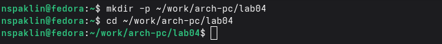{#fig-01 width=100%}

Создаю файл "hello.asm" с помощью команды `touch` (рис. -@fig-02).

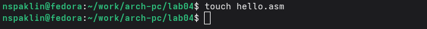{#fig-02 width=100%}

С помощью текстового редактора gedit ввожу код для вывода текста `Hello world!` на экран (рис. -@fig-03).

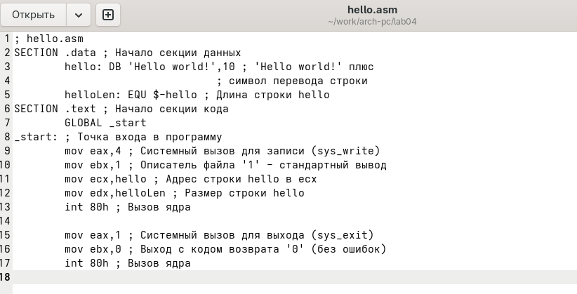{#fig-03 width=100%}

## Транслятор NASM

Компилирую файл "hello.asm" с помощью транслятора NASM и проверяю его наличие с помощью команды `ls`. Как видно, объектный файл получил название "hello.o" (рис. -@fig-04)

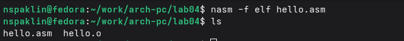{#fig-04 width=100%}

## Расширенный синтаксис командной строки NASM

Выполняю команду для компиляции файла "hello.asm" в "obj.o" с форматом elf и с включением символов отладки, а также создания файла листинга "list.lst". Проверяю их наличие с помощью команды `ls` (рис. -@fig-05).

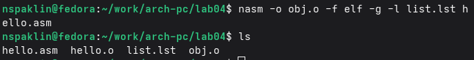{#fig-05 width=100%}

## Компоновщик LD

Компоную файл с помощью команды `ld` для получения исполняемой программы. После этого проверяю её наличие с помощью команды `ls` (рис. -@fig-06).

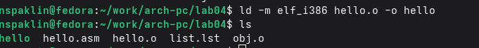{#fig-06 width=100%}

Выполняю команду для компоновки программы в исполняемый файл с названием "main" из объектного файла "obj.o". (рис. -@fig-07)

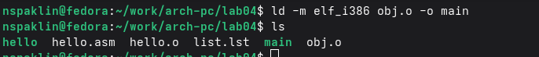{#fig-07 width=100%}

## Запуск исполняемого файла

Запускаю файл, введя команду `./hello` (рис. -@fig-08).

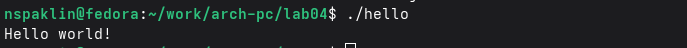{#fig-08 width=100%}

# Задания для самостоятельной работы

1. Создаю копию файла "hello.asm" с названием "lab4.asm" (рис. -@fig-09).

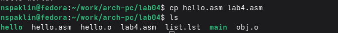{#fig-09 width=100%}

2. Редактирую код в файле таким образом, чтобы вместо `Hello world!` на экран выводились мои имя и фамилия (рис. -@fig-10).

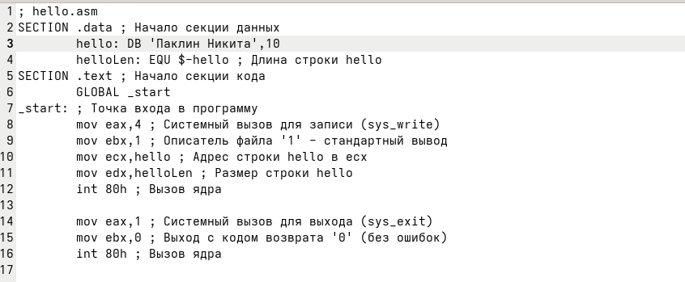{#fig-10 width=100%}

3. Компилирую программу "lab4.asm" в объектный файл, компоную его и запускаю исполняемый файл (рис. -@fig-11).

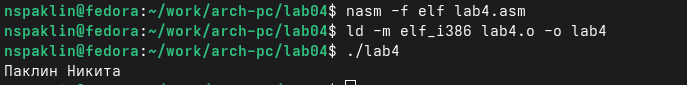{#fig-11 width=100%}

4. Копирую файлы "hello.asm" и "lab4.asm" в локальный репозиторий, после чего отправляю их на GitHub (рис. -@fig-12, -@fig-13).

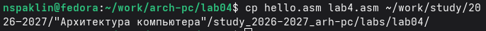{#fig-12 width=100%}

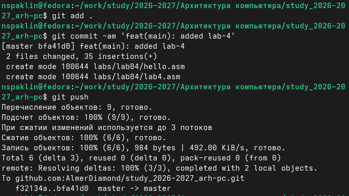{#fig-13 width=100%}

# Вывод

Освоил процедуру компиляции и сборки программ, написанных на ассемблере NASM.
