---
## Author
author:
  name: Паклин Никита Сергеевич
  affiliation:
    - name: Российский университет дружбы народов
      country: Российская Федерация
      postal-code: 117198
      city: Москва
      address: ул. Миклухо-Маклая, д. 6

## Title
title: "Отчёт по лабораторной работе №5"
subtitle: "Основы работы с **Midnight Commander** (mc). Структура программы на языке ассемблера NASM"
license: "CC BY"
abstract: |
keywords: [лабораторная работа, шаблон, Markdown, Pandoc]
---

# Цель работы

Приобретение практических навыков работы в Midnight Commander. Освоение инструкций языка ассемблера mov и int.

# Выполнение лабораторной работы

Открываю Midnight Commander с помощью команды `mc`. (рис. -@fig-01, -@fig-02)

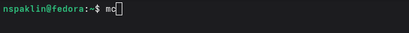{#fig-01 width=100%}

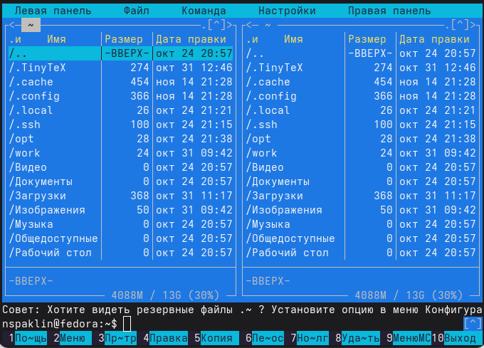{#fig-02 width=100%}

Перехожу в каталог "arch-pc" (рис. -@fig-03).

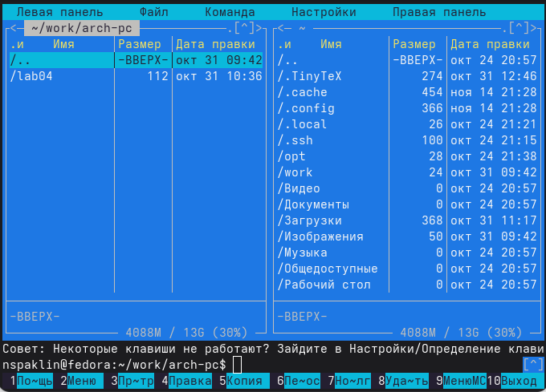{#fig-03 width=100%}

Создаю новый каталог "lab05" (рис. -@fig-04)

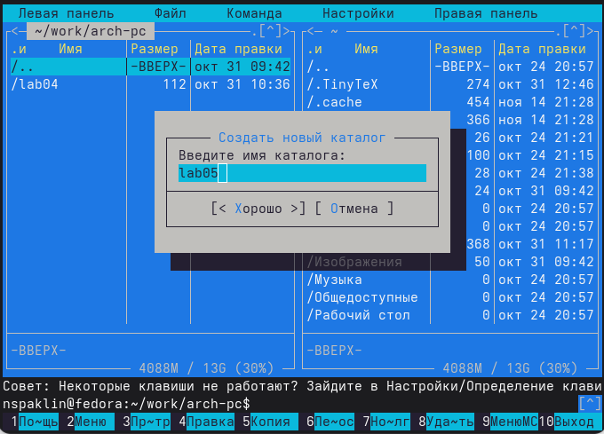{#fig-04 width=100%}

С помощью команды `touch` создаю файл "lab5-1.asm". (рис. -@fig-05).

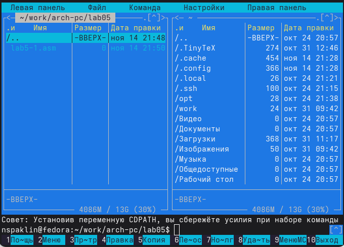{#fig-05 width=100%}

Ввожу текст программы в созданный файл. (рис. -@fig-06).

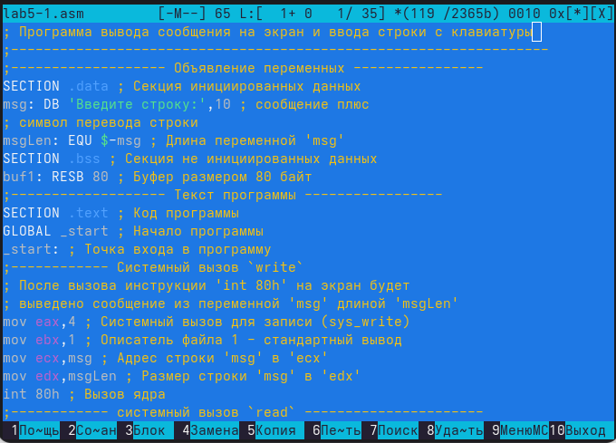{#fig-06 width=100%}

Проверяю введённый текст с помощью функций Midnight Commander. (рис. -@fig-07)

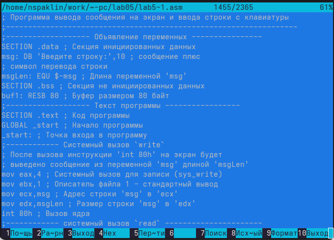{#fig-07 width=100%}

Транслирую программу в объектный файл, компоную его, а затем запускаю. Программа выводит текст "Введите строку:" и принимает на ввод текст. Ввожу в терминал свои ФИО. (рис. -@fig-08).

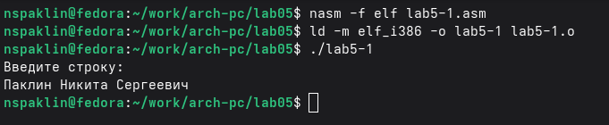{#fig-08 width=100%}

## Подключение внешнего файла in_out.asm

Скачиваю файл "in_out.asm" со страницы в ТУИС. Копирую файл в тот же каталог, что и файл "lab5-1.asm". (рис. -@fig-09).

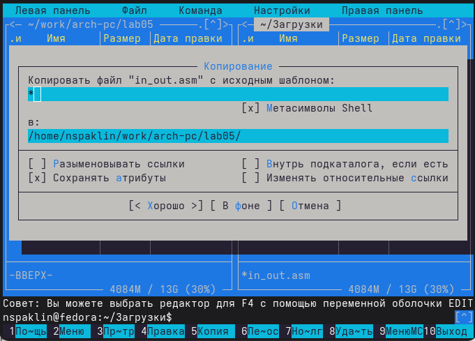{#fig-09 width=100%}

Копирую файл "lab5-1.asm" с именем "lab5-2.asm". (рис. -@fig-10).

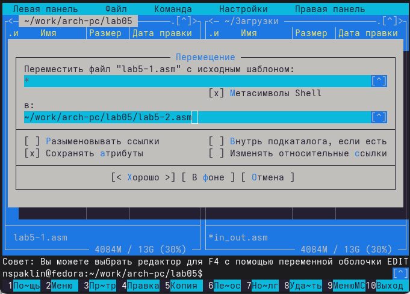{#fig-10 width=100%}

Меняю текст программы "lab5-2.asm" на новый с использованием подпрограмм "in_out.asm". (рис. -@fig-11).

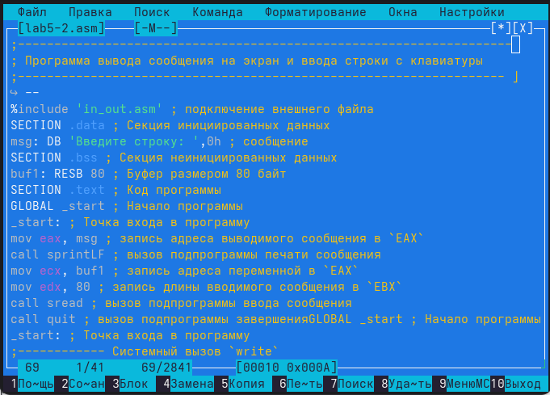{#fig-11 width=100%}

Компилирую и запускаю программу. Она выводит текст "Введите строку:" и принимает на ввод текст. (рис. -@fig-12).

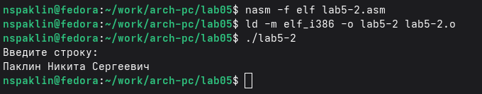{#fig-12 width=100%}

Заменяю подпрограмму в файле "lab5-2.asm" `sprintLF` на `sprint`. Затем заново компилирую файл и запускаю его. Разница с прошлой программой в том, что ввод текста происходит в той же самой строке, а не переносится на следующую. (рис. -@fig-13, -@fig-14)

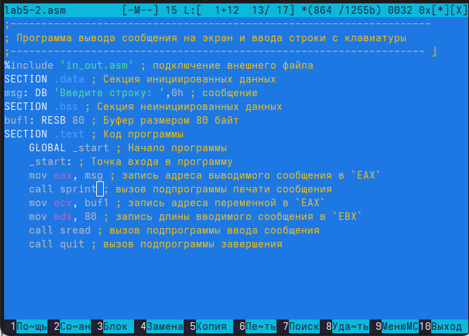{#fig-13 width=100%}

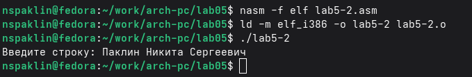{#fig-14 width=100%}

# Выполнение заданий для самостоятельной работы

1. Создаю копию файла "lab5-1.asm", а затем изменяю текст программы так, чтобы помимо получения текста на ввод она выводила этот текст на экран. (рис. -@fig-15)

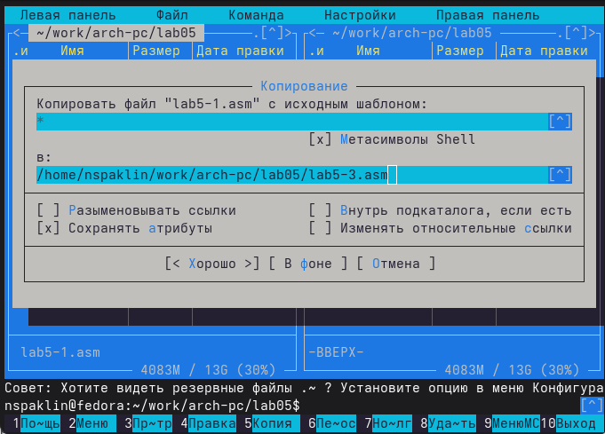{#fig-15 width=100%}

2. Создаю исполняемый файл, запускаю его и проверяю его исполнение. (рис. -@fig-16)

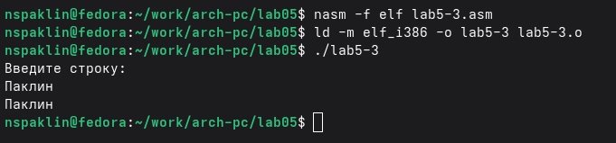{#fig-16 width=100%}

3. Создаю копию файла "lab5-2.asm", а затем изменяю текст программы так, чтобы помимо получения текста на ввод она выводила этот текст на экран. (рис. -@fig-17)

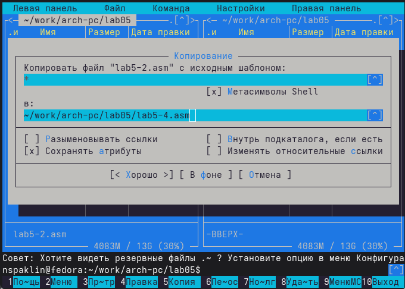{#fig-17 width=100%}

4. Создаю исполняемый файл, запускаю его и проверяю его исполнение. (рис. -@fig-18)

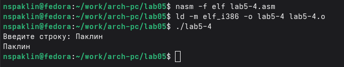{#fig-18 width=100%}

# Вывод

Приобрёл практические навыки работы в Midnight Commander. Освоил инструкции языка ассемблера mov и int.
