---
## Author
author:
  name: Паклин Никита Сергеевич
  affiliation:
    - name: Российский университет дружбы народов
      country: Российская Федерация
      postal-code: 117198
      city: Москва
      address: ул. Миклухо-Маклая, д. 6

## Title
title: "Отчёт по лабораторной работе №6"
subtitle: "Арифметические операции в NASM"
license: "CC BY"
abstract: |
keywords: [лабораторная работа, шаблон, Markdown, Pandoc]
---

# Цель работы

Освоение арифметических инструкций языка ассемблера NASM.

# Выполнение лабораторной работы

##  Символьные и численные данные в NASM

Создаю каталог для выполнения лабораторной работы и файл "lab6-1.asm" в нём. (рис. -@fig-01)

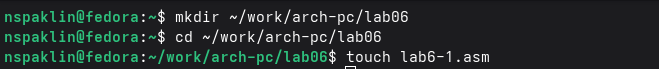{#fig-01 width=100%}

Ввожу текст программы из листинга. (рис. -@fig-02)

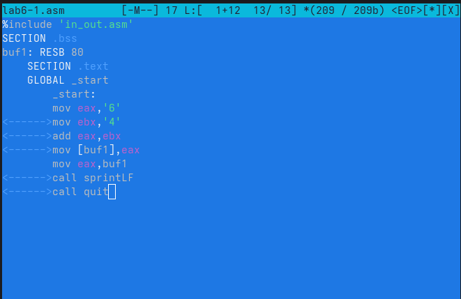{#fig-02 width=100%}

Создаю исполняемый файл и запускаю его. На экран выводится символ "j", так как сложение кодов символов является кодом символа "j". (рис. -@fig-03).

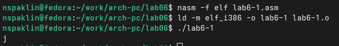{#fig-03 width=100%}

Изменяю текст программы: убираю кавычки. (рис. -@fig-04)

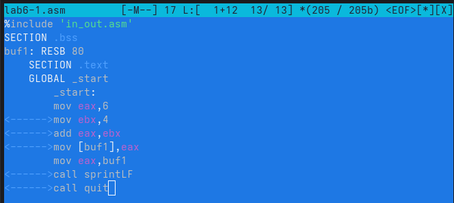{#fig-04 width=100%}

Создаю новый исполняемый файл и запускаю его. В этот раз на экран не выводится ничего, так как символ с кодом 10 - перевод строки. (рис. -@fig-05).

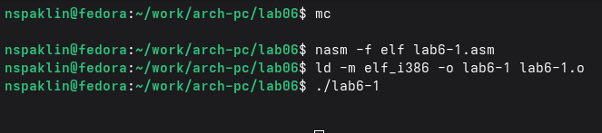{#fig-05 width=100%}

Создаю новый файл "lab6-2.asm". (рис. -@fig-06).

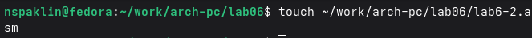{#fig-06 width=100%}

Ввожу текст программы в файл. (рис. -@fig-07)

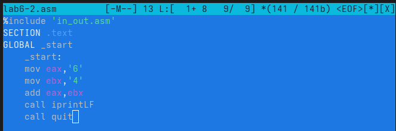{#fig-07 width=100%}

Создаю исполняемый файл и запускаю его. На экран выводится число 106. (рис. -@fig-08).

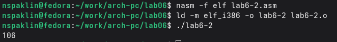{#fig-08 width=100%}

Снова изменяю текст программы, удаляя кавычки. (рис. -@fig-09).

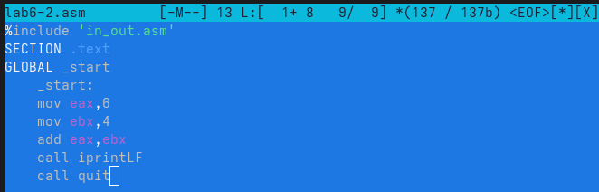{#fig-09 width=100%}

Создаю и запускаю исполняемый файл. На экран выводится число 10. (рис. -@fig-10).

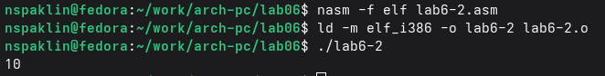{#fig-10 width=100%}

Изменяю текст программы, заменив "iprintLF" на "iprint". При запуске так же выводится число 10, но переноса строки не происходит. (рис. -@fig-11, -@fig-12).

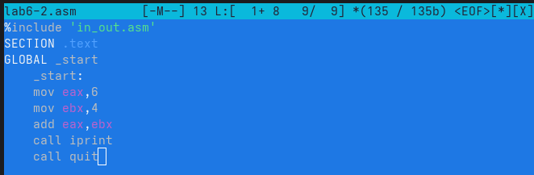{#fig-11 width=100%}

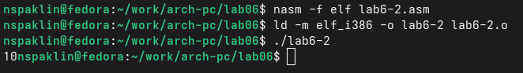{#fig-12 width=100%}

## Выполнение арифметических операций в NASM

Создаю новый файл "lab6-3.asm" и ввожу в него текст программы из листинга для вычисления выражения (5 * 2 + 3)/3. (рис. -@fig-13, -@fig-14)

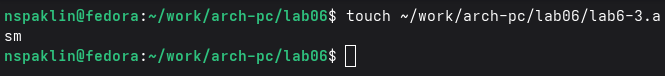{#fig-13 width=100%}

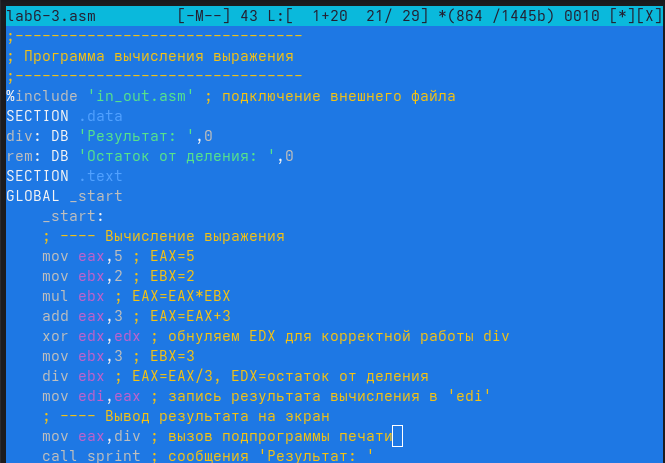{#fig-14 width=100%}

Запускаю исполняемый файл. На экран выводится оформленный результат и остаток от вычисления. (рис. -@fig-15)

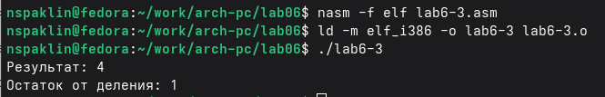{#fig-15 width=100%}

Изменяю программу таким образом, чтобы происходило вычисление выражения (4 * 6 + 2)/5. (рис. -@fig-16)

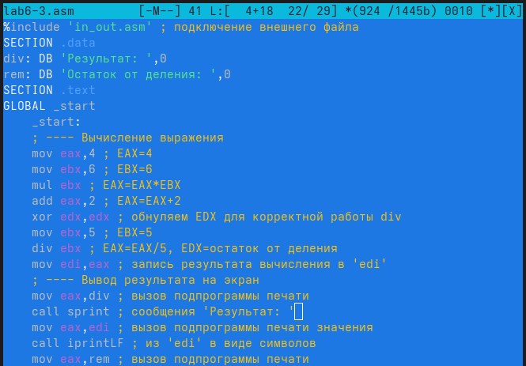{#fig-16 width=100%}

Запускаю программу. На экран выводится результат вычислений. (рис. -@fig-17)

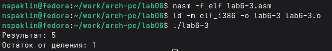{#fig-17 width=100%}

Создаю файл "variant.asm". Ввожу в него текст программы для вычисления варианта для следующего задания. (рис. -@fig-18, -@fig-19)

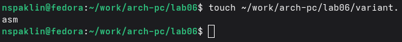{#fig-18 width=100%}

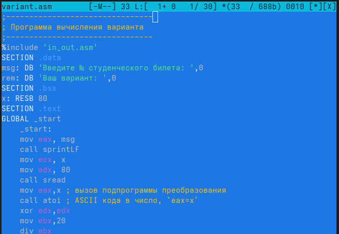{#fig-19 width=100%}

Создаю и запускаю исполняемый файл. Ввожу свой номер студенческого билета и программа выводит мой вариант: 11. (рис. -@fig-20)

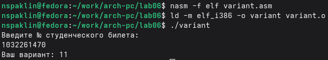{#fig-20 width=100%}

1. Какие строки листинга 6.4 отвечают за вывод на экран сообщения „Ваш вариант:“?
```
rem: DB 'Ваш вариант: ',0
mov eax,rem
call sprint
```

2. Для чего используются следующие инструкции?
```
mov ecx, x
mov edx, 80
call sread
```
- Для ввода значения в переменную x с клавиатуры

3. Для чего используется инструкция call atoi?
- Для преобразования кода ASCII в число

4. Какие строки листинга 6.4 отвечают за вычисления варианта?
```
xor edx,edx
mov ebx,20
div ebx
inc edx
```

5. В какой регистр записывается остаток от деления при выполнении инструкции
div ebx?
- edx

6. Для чего используется инструкция inc edx?
- Для увеличения значения в регистре edx на 1

7. Какие строки листинга 6.4 отвечают за вывод на экран результата вычислений?
```
mov eax,rem
call sprint
mov eax,edx
call iprintLF
```

# Выполнение заданий для самостоятельной работы

Создаю файл для вычисления функции f(x). Так как мой вариант 11, моя функция f(x) = 10(x + 1) - 10. Ввожу текст программы для вычисления на языке NASM. (рис. -@fig-21)

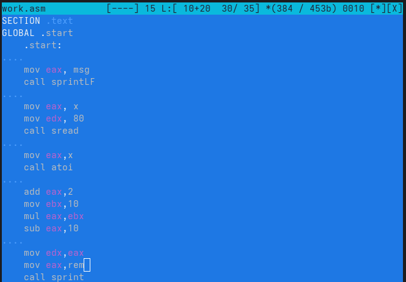{#fig-21 width=100%}

Запускаю программу. Она запрашивает на ввод переменную x. Для проверки ввожу числа x1 = 1 и x2 = 7. Программа выводит на экран правильные результаты: 10 и 70 соответственно.

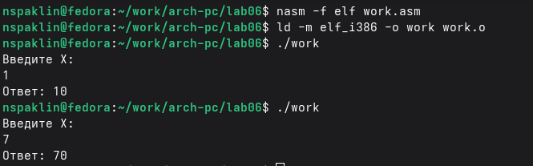{#fig-22 width=100%}

# Вывод

Освоил арифметические инструкции языка ассемблера NASM.
